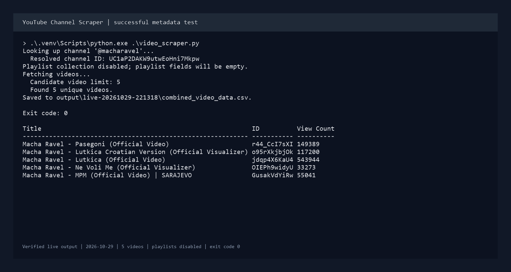

# YouTube Channel Scraper

Collect video metadata and playlist relationships for a YouTube channel, then optionally use a browser to extract chapter names and timestamps. The CSV and JSON outputs are useful for a content audit, a searchable video catalog, or a downstream reporting workflow.

The API and browser steps are separate scripts. Their existing playlist matching, chapter selectors, and merge precedence are preserved. Optional limits let you stop after a small number of video candidates or skip playlist traversal for a metadata-only test.

## Preview



The image renders terminal output from the user's live test on 2026-10-29, checked against the saved CSV. See the [terminal excerpt](docs/live-run.txt) and [run details](docs/live-run.json). This is a metadata-only run, not a demonstration of playlist or chapter collection.

### Live test result

The query `@macharavel` resolved to channel `UC1aP2DAKW9utwEoHni7Mkpw`. With `YOUTUBE_MAX_VIDEOS=5` and `YOUTUBE_INCLUDE_PLAYLISTS=false`, the script exported five unique videos and exited with code 0. This verifies channel lookup, video-detail collection, and CSV export. Playlist fields were intentionally empty. Playlist and browser chapter collection are covered by offline tests but have not been tested live during this review.

## What it does

- Searches for a configured channel and prints the resolved channel ID.
- Exports video titles, IDs, URLs, publication dates, view counts, durations, descriptions, timestamp matches, and playlist titles.
- Exports a separate video-to-playlist URL mapping.
- Reads a chosen list of video IDs and uses Chrome to collect chapter labels and timestamps.
- Combines chapter JSON files, keeping the first file's entry when both contain the same video ID.

## Run locally

Use Python 3.10 or newer. The API scripts need a YouTube Data API v3 key. The chapter script needs Chrome and a working Chrome driver setup, but does not need an API key.

```bash
git clone https://github.com/miahela/youtube-channel-scraper.git
cd youtube-channel-scraper
python -m venv .venv
```

Activate the virtual environment:

```powershell
# Windows PowerShell
.\.venv\Scripts\Activate.ps1
```

```bash
# macOS / Linux
source .venv/bin/activate
```

Install the existing runtime requirements:

```bash
python -m pip install -r requirements.txt
```

Copy `.env.example` to `.env`:

```powershell
# Windows PowerShell
Copy-Item .env.example .env
```

```bash
# macOS / Linux
cp .env.example .env
```

Enable YouTube Data API v3 in your Google Cloud project, create an API key, and fill in these settings:

```dotenv
YOUTUBE_API_KEY=your_actual_key
YOUTUBE_CHANNEL=your_channel_name_or_handle
```

Keep `.env` private. Existing environment variables override `.env`, which is loaded from beside `config.py`. The key is checked when an API script runs, so importing modules or running browser/merge steps does not require credentials.

## Run the workflow

### 1. Export metadata

```bash
python video_scraper.py
```

Writes `output/combined_video_data.csv`. The script first collects playlist membership, then searches for videos and retrieves details. Check the printed channel ID: channel selection uses the first search match, not an exact handle lookup.

For a small first test, set `YOUTUBE_MAX_VIDEOS=5` and `YOUTUBE_INCLUDE_PLAYLISTS=false`. This skips playlist requests and leaves the CSV's playlist fields empty intentionally. The limit counts distinct candidate IDs, including unavailable videos whose details return no rows, so an export can contain fewer than five videos.

### 2. Export playlist links

```bash
python playlist_scraper.py
```

Writes `output/video_playlist_link_data.csv`. This is a separate API collection run, so it repeats the channel, playlist, and video searches.

This script requires `YOUTUBE_INCLUDE_PLAYLISTS=true`. The video-row limit does not limit playlist traversal, so leave this step out of the first small live test.

### 3. Extract chapters for a small input list

Create `video_ids.txt` with one video ID per line. To start with two IDs from the metadata export in PowerShell:

```powershell
Import-Csv .\output\combined_video_data.csv |
    Select-Object -First 2 -ExpandProperty ID |
    Set-Content -Encoding utf8 .\video_ids.txt
```

Then run:

```bash
python chapter_scraper.py
```

Writes `output/data_s2.json`, saving progress after each video. Browser logs go to `output/info.log` and `output/error.log`. Failed IDs are written to `output/failed_video_ids.txt`; if any video fails, the script exits with an error after processing the remaining IDs. To retry just those videos, point `YOUTUBE_VIDEO_IDS_FILE` at that file.

### 4. Merge chapter runs

```bash
python merge_chapter_data.py
```

Combines the optional `YOUTUBE_CHAPTER_BASE_FILE` with the current `output/data_s2.json` into `output/datafinal.json`. Missing inputs are reported and skipped. If no input exists, or an existing input is malformed, the command fails without replacing the merged export. A single current chapter file is enough for a first run.

For repeated chapter runs, copy the prior result to another file and configure it as `YOUTUBE_CHAPTER_BASE_FILE` before starting the next run. The browser script starts a new in-memory result each time; it does not automatically resume or merge prior progress.

## Configuration

All paths are relative to the directory where you run the command. Run from the repo root for the examples above.

| Variable | Default | Purpose |
|---|---|---|
| `YOUTUBE_API_KEY` | Empty | Required for the two API scripts |
| `YOUTUBE_CHANNEL` | Empty | Channel search query; required for the API scripts |
| `YOUTUBE_OUTPUT_DIR` | `output` | Generated CSV, JSON, and browser logs |
| `YOUTUBE_VIDEO_IDS_FILE` | `video_ids.txt` | Browser input, one video ID per line |
| `YOUTUBE_CHAPTER_BASE_FILE` | `<output dir>/data_s.json` | Optional earlier chapter run |
| `YOUTUBE_BROWSER_WAIT` | `5` | Browser element timeout in seconds, greater than zero |
| `YOUTUBE_PAGE_DELAY` | `2` | Pause after navigation and expanding descriptions, at least zero |
| `YOUTUBE_MAX_VIDEOS` | `0` | Non-negative limit on metadata candidate IDs, playlist-map rows, or browser input IDs; 0 means no limit |
| `YOUTUBE_INCLUDE_PLAYLISTS` | `true` | Set false to skip all playlist traversal in the metadata script |

The example `.env` explicitly sets the base chapter path. If you change the output folder, update that path too. Generated folders `output/`, `outputs/`, `downloads/`, and `runs/` are ignored by Git, along with `.env`, `.venv`, and the root video-ID file. The old `data/` and `data manipulations/` locations are ignored too, so restored exports are not accidentally added again. Custom output locations need their own ignore rules.

## Included sample

The [video metadata sample](samples/videos.csv) contains **8 distinct videos** from a historical export. It uses the current CSV column names; descriptions are shortened to 200 characters to keep it small. It is an output-format example, not a new live run. See [sample notes](samples/README.md).

The full channel dataset and repeated intermediate exports were copied to a hash-verified backup outside the repo before removal from the working tree. They are no longer part of the current project files. Git history has not been rewritten. New runs write into ignored output folders and do not overwrite the sample.

## Errors and current limits

- API failures show the HTTP status without printing the request URL, which can contain the API key. Check API access, key restrictions, and available quota. A failed API collection does not write a complete new CSV.
- There is no global HTTP-request cap, automatic API retry, or API checkpoint/resume. The video limit bounds candidate detail requests, not every search or playlist request. Use the five-video limit with playlist collection disabled for your first metadata run. Playlist traversal can make many requests before video collection begins when enabled.
- Video enumeration uses `search.list`, not the uploads playlist. Google documents a 500-video limit for this channel search pattern and warns that search indexing can omit results. This is not a guaranteed complete channel archive. See the [official search documentation](https://developers.google.com/youtube/data/reference/rest/v3/search/list).
- Metadata results deduplicate video IDs. The separate playlist-map script preserves its original behavior and can include duplicate search rows.
- Description timestamp matches are a simple regular expression. They are not validated chapter structures and may not represent a video's actual chapters.
- YouTube layout changes, consent screens, videos without chapters, and browser/driver issues can prevent chapter collection. Startup and navigation failures are recorded per video and browser cleanup is attempted.
- The existing chapter carousel logic and selectors are unchanged. It has no chapter-page cap, and it does not guarantee deduplicated timestamps.
- Generated outputs overwrite previous files at the same paths. A failed-ID file or API export from an earlier run can remain when a later run writes no replacement. Use a fresh output folder when comparing runs.

## Checks

```bash
python -m unittest discover -s tests -v
```

Offline fixtures check video pagination/deduplication, the small-run limits, skipped playlist traversal, configured export paths, browser failures/cleanup, API key-safe errors, and chapter merges. They make no YouTube API calls and do not launch Chrome.

## Stack

Python, google-api-python-client, YouTube Data API v3, Selenium/Chrome, python-dotenv, and standard-library CSV/JSON tools.

```text
youtube-channel-scraper/
  video_scraper.py        Video metadata and playlist-title export
  playlist_scraper.py     Video-to-playlist URL export
  chapter_scraper.py      Browser chapter collection
  selenium_manager.py    Browser wrapper and logging
  merge_chapter_data.py  Chapter merge utility
  config.py              Shared environment settings
  .env.example           Configuration template
  requirements.txt       Runtime dependencies
  tests/                 Offline checks
  samples/videos.csv     Small historical sample of eight videos
  docs/                  Live metadata test and terminal-output image
  output/                Ignored generated files
```
